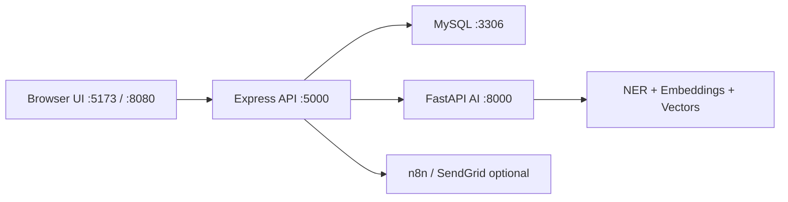
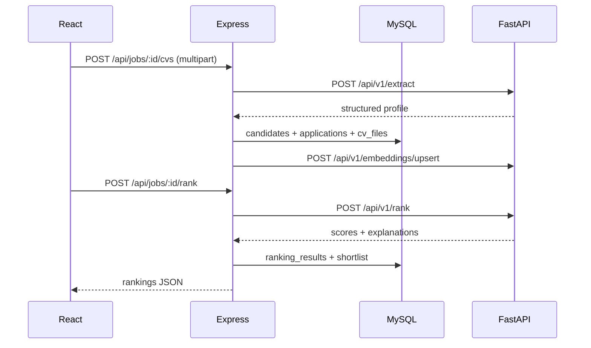

# ScreenWise — Full Project Documentation

**Project title:** AI-Based Intelligent CV Screening and Candidate Ranking System for Multi-Industry Recruitment  

**Type:** BSc (Hons) Computer Science (Software Engineering) Final Year Research Project  

**Product name:** ScreenWise  

**Repository root:** `cv_screening/`

This document is the master reference for architecture, setup, APIs, data model, AI models, frontend portals, deployment, and research metrics. Phase-specific deep dives live under [`docs/`](./) (linked below).

---

## Table of contents

1. [Overview](#1-overview)
2. [Architecture](#2-architecture)
3. [Repository layout](#3-repository-layout)
4. [Technology stack](#4-technology-stack)
5. [Prerequisites](#5-prerequisites)
6. [Local development setup](#6-local-development-setup)
7. [Docker / production demo](#7-docker--production-demo)
8. [Environment variables](#8-environment-variables)
9. [Seed users and ports](#9-seed-users-and-ports)
10. [Database schema](#10-database-schema)
11. [AI service (Phase 1 + 4)](#11-ai-service-phase-1--4)
12. [Backend API (Phase 2 + 4/5)](#12-backend-api-phase-2--45)
13. [Frontend (Phase 3 + premium redesign)](#13-frontend-phase-3--premium-redesign)
14. [End-to-end workflows](#14-end-to-end-workflows)
15. [Training, evaluation, and metrics](#15-training-evaluation-and-metrics)
16. [Optional integrations](#16-optional-integrations)
17. [Testing](#17-testing)
18. [Troubleshooting](#18-troubleshooting)
19. [Documentation map](#19-documentation-map)
20. [Dissertation / viva notes](#20-dissertation--viva-notes)

---

## 1. Overview

ScreenWise is a multi-industry recruitment platform that:

1. **Extracts** structured candidate profiles from CV files (PDF / DOCX / images) using OCR + NLP/NER.
2. **Ranks** candidates against a job using Sentence-Transformers embeddings and **industry-weighted** scoring with explanations.
3. **Persists** jobs, candidates, applications, rankings, interviews, and notifications in MySQL.
4. **Searches** candidates semantically (RAG) via Pinecone or a local vector index.
5. **Schedules** interviews with optional n8n / SendGrid automation hooks.
6. Exposes a **premium React SaaS UI** with Admin, HR, and Candidate (demo) portals.



**Trust boundary:** The browser never calls the AI service directly. All extraction, ranking, and search go through the Express backend.

---

## 2. Architecture

| Layer | Responsibility |
|-------|----------------|
| **Frontend** | Auth UX, dashboards, job/CV/ranking/search/interview UI; Axios + TanStack Query |
| **Backend** | JWT auth, authorization, Multer uploads, MySQL repositories, AI client, interview/notifications |
| **AI service** | OCR, spaCy NER, section parsing, communication score, ranking, embeddings upsert/search |
| **MySQL** | Normalized multi-tenant HR data (jobs scoped to `hr_managers`) |
| **Vectors** | Pinecone (if `PINECONE_API_KEY`) else local `models/vectors/local_index.npz` |

### Request flow — CV upload → rank



---

## 3. Repository layout

```
cv_screening/
├── README.md                 # Quick start + phase status
├── AUDIT_HISTORY.md          # Audit trail / findings
├── docker-compose.yml        # Phase 6 full stack
├── .env.example              # Compose env template
├── docs/                     # This guide + phase docs
│   ├── DOCUMENTATION.md      # ← you are here
│   ├── PHASE1_AI_MODELS.md
│   ├── PHASE2_BACKEND.md
│   ├── PHASE3_FRONTEND.md
│   ├── PHASE4_SEMANTIC_SEARCH.md
│   ├── PHASE5_INTERVIEWS.md
│   ├── PHASE6_DEPLOY.md
│   └── n8n-interview-webhook.sample.json
├── ai-service/               # Python FastAPI
│   ├── app/                  # MVC: api, services, schemas
│   ├── training/             # train_ner, train_ranker
│   ├── models/               # NER weights, ranking metrics, vectors
│   ├── Dockerfile
│   └── requirements.txt
├── backend/                  # Node Express
│   ├── src/                  # controllers, services, repositories, routes
│   ├── sql/                  # schema.sql, migrations
│   ├── docker-compose.yml    # MySQL-only (local)
│   └── Dockerfile
├── frontend/                 # React Vite Tailwind
│   ├── src/pages/            # landing, auth, hr, admin, candidate, workspace
│   ├── src/components/       # UI kit, charts, shell
│   └── Dockerfile + nginx.conf
└── datasets/                 # Optional local dataset stubs (gitignored CSVs)
```

Proposal / Kaggle materials (training): often at `D:\cv screening system` via `DATASETS_DIR`.

---

## 4. Technology stack

| Area | Stack |
|------|--------|
| AI | Python 3.11+, FastAPI, spaCy, PyMuPDF, python-docx, Tesseract (optional), Sentence-Transformers (`all-MiniLM-L6-v2`), Pinecone optional |
| Backend | Node.js 18+, Express, mysql2, JWT, bcryptjs, Multer, Winston, Axios |
| Frontend | React 19, Vite 8, Tailwind CSS v4, Radix/shadcn-style UI, Framer Motion, Recharts, FullCalendar, TanStack Query, RHF, react-hot-toast |
| DB | MySQL 8.0+ |
| Deploy | Docker Compose (mysql + ai + backend + nginx frontend) |

---

## 5. Prerequisites

- **Node.js** ≥ 18 and npm  
- **Python** 3.11+ (3.14 used in some local builds) with venv  
- **MySQL** 8.0+ (or Docker for MySQL)  
- Optional: **Tesseract OCR** for scanned image CVs  
- Optional: **Docker Desktop** for one-command full-stack demo  
- Trained NER model at `ai-service/models/extraction/ner_model/` (gitignored — train locally if missing)

---

## 6. Local development setup

### 6.1 AI service

```bash
cd ai-service
python -m venv .venv
.venv\Scripts\activate
pip install -r requirements.txt
copy .env.example .env

# If NER missing:
python -m training.train_ner --epochs 15 --weak-rows 300

.venv\Scripts\python.exe -m uvicorn app.main:app --host 0.0.0.0 --port 8000
```

- Docs: http://localhost:8000/docs  
- Health: http://localhost:8000/api/v1/health  

### 6.2 Backend + MySQL

```bash
cd backend
npm install
copy .env.example .env
# Set DB_HOST, DB_USER, DB_PASSWORD, DB_NAME, AI_SERVICE_URL=http://localhost:8000

# Option A: Docker MySQL only
docker compose up -d

# Option B: local MySQL (empty password common on Windows — set DB_PASSWORD=)

npm run db:init
node src/server.js
# or: npm run dev
```

- Health: http://localhost:5000/api/health  

### 6.3 Frontend

```bash
cd frontend
npm install
# .env: leave VITE_API_URL empty to use Vite proxy /api → :5000
npm run dev -- --host 0.0.0.0 --port 5173
```

- App: **http://localhost:5173** (landing → portals)  
- Do **not** use `:8000/docs` as the product UI  

---

## 7. Docker / production demo

See [PHASE6_DEPLOY.md](./PHASE6_DEPLOY.md).

```bash
# From repo root
copy .env.example .env
# Set JWT_SECRET (≥16 characters)

docker compose up --build
```

| Service | Host URL |
|---------|----------|
| UI (nginx) | http://localhost:8080 |
| Backend | http://localhost:5000 |
| AI | http://localhost:8000 |
| MySQL | localhost:3306 |

Frontend builds with empty `VITE_API_URL`; nginx proxies `/api` → backend (same-origin).

**NER note:** Image build fails if `models/extraction/ner_model/ner/model` is missing on the build host.

---

## 8. Environment variables

### Root (Compose) — `.env.example`

`FRONTEND_PORT`, `BACKEND_PORT`, `AI_PORT`, `MYSQL_PORT`, `DB_*`, `JWT_SECRET`, `JWT_EXPIRES_IN`, `CORS_ORIGINS`, optional `PINECONE_*`, `N8N_WEBHOOK_URL`, `SENDGRID_*`, `GOOGLE_CALENDAR_ENABLED`, `AI_TIMEOUT_MS`.

### Backend — `backend/.env.example`

`PORT`, `NODE_ENV`, `DB_*`, `JWT_*`, `AI_SERVICE_URL`, `AI_TIMEOUT_MS`, `UPLOAD_DIR`, `MAX_UPLOAD_MB`, `MAX_BULK_FILES`, `SHORTLIST_TOP_FRACTION`, `CORS_ORIGINS`, Phase 5 optional hooks.

Production: `JWT_SECRET` must be set and ≥16 characters when `NODE_ENV=production`.

### AI — `ai-service/.env.example`

`HOST`, `PORT`, `DATASETS_DIR`, `NER_MODEL_PATH`, `RANKING_MODEL_PATH`, `EMBEDDING_MODEL_NAME`, `PINECONE_*`, `TESSERACT_CMD`, `OCR_LANGUAGE`, upload limits, `CORS_ORIGINS`.

### Frontend — `frontend/.env.example`

`VITE_API_URL` — empty for same-origin / Vite proxy; or absolute backend URL.

---

## 9. Seed users and ports

| Email | Password | Role |
|-------|----------|------|
| `admin@cvscreening.local` | `Password123!` | admin |
| `hr@cvscreening.local` | `Password123!` | hr |

Created by `npm run db:init` (idempotent unless `DB_FORCE_RESET=true`).

| Context | Frontend | Backend | AI | MySQL |
|---------|----------|---------|-----|-------|
| Local | 5173 | 5000 | 8000 | 3306 |
| Docker | 8080 | 5000 | 8000 | 3306 |

**Design note:** Admins without an `hr_managers` row cannot create jobs. Use the HR seed account for job CRUD demos.

---

## 10. Database schema

Database: `cv_screening` (utf8mb4). Source: [`backend/sql/schema.sql`](../backend/sql/schema.sql). Additive migration: [`backend/sql/migration_phase4_5.sql`](../backend/sql/migration_phase4_5.sql).

| Table | Purpose |
|-------|---------|
| `users` | Auth accounts (`admin` \| `hr`) |
| `hr_managers` | HR profile linked to user |
| `skills` / `job_skills` / `candidate_skills` | Normalized skills |
| `jobs` | Vacancies + industry + JSON `ranking_weights` + status |
| `candidates` | Extracted profiles (JSON sections, contact, scores) |
| `cv_files` | Stored upload metadata + extraction status |
| `applications` | Candidate ↔ job link + pipeline status |
| `ranking_results` | Scores, position, criterion JSON |
| `notifications` | In-app alerts |
| `interviews` | Schedule / reschedule / cancel metadata |

There is **no** `candidate` user role in the database. The frontend Candidate portal is a **demo** session only.

---

## 11. AI service (Phase 1 + 4)

Details: [PHASE1_AI_MODELS.md](./PHASE1_AI_MODELS.md), [PHASE4_SEMANTIC_SEARCH.md](./PHASE4_SEMANTIC_SEARCH.md), [`ai-service/README.md`](../ai-service/README.md).

### Models

| Model | Input | Output |
|-------|--------|--------|
| **Extraction** | CV file bytes | Name, contact, skills, education, experience, projects, communication score, raw text |
| **Ranking** | Job requirements + candidate profiles | Overall score, matching %, criterion breakdown, strengths/gaps |
| **Embeddings / search** | Text | Vector upsert + NL similarity search |

### HTTP API (`/api/v1`)

| Method | Path | Purpose |
|--------|------|---------|
| GET | `/health` | Health + `ner_model_loaded`, `embedding_model_loaded`, `vector_backend` |
| POST | `/extract` | Single CV extraction |
| POST | `/extract/bulk` | Bulk extraction |
| POST | `/rank` | Rank candidates for a job |
| POST | `/rank/batch` | Batch ranking alias |
| GET | `/ranking/weights/{industry}` | Weight template |
| GET | `/ranking/industries` | Industry list |
| POST | `/embeddings/upsert` | Index vectors |
| POST | `/search` | Semantic search |
| DELETE | `/embeddings?ids=` | Delete vectors |

Industries include: `it`, `tourism`, `healthcare`, `government`, `finance`, `retail`, `education`, `manufacturing`, `default`.

---

## 12. Backend API (Phase 2 + 4/5)

Details: [PHASE2_BACKEND.md](./PHASE2_BACKEND.md), [`backend/README.md`](../backend/README.md).

Base URL: `http://localhost:5000`  
Auth: `Authorization: Bearer <JWT>`

| Method | Path | Auth | Description |
|--------|------|------|-------------|
| GET | `/` | Public | Service info |
| GET | `/api/health` | Public | DB + AI health |
| POST | `/api/auth/register` | Public* | Register HR (*admin creation needs admin JWT) |
| POST | `/api/auth/login` | Public | Login → token + user |
| GET | `/api/auth/me` | HR/Admin | Current user |
| GET/POST | `/api/jobs` | HR/Admin | List / create |
| GET/PUT/DELETE | `/api/jobs/:id` | HR/Admin | CRUD |
| POST | `/api/jobs/:id/close` | HR/Admin | Close |
| POST | `/api/jobs/:id/duplicate` | HR/Admin | Duplicate |
| POST | `/api/jobs/:jobId/cvs` | HR/Admin | Single CV (`file`) |
| POST | `/api/jobs/:jobId/cvs/bulk` | HR/Admin | Bulk (`files`) |
| GET | `/api/jobs/:jobId/candidates` | HR/Admin | Pipeline list |
| POST | `/api/jobs/:jobId/rank` | HR/Admin | Rank + persist |
| GET | `/api/jobs/:jobId/rankings` | HR/Admin | Stored rankings |
| GET | `/api/jobs/:jobId/interviews` | HR/Admin | Job interviews |
| GET | `/api/dashboard/stats` | HR/Admin | KPIs |
| GET | `/api/candidates/:id` | HR/Admin | Profile |
| GET | `/api/ranking/industries` | JWT | Proxy AI |
| GET | `/api/ranking/weights/:industry` | JWT | Proxy AI |
| POST | `/api/search` | HR/Admin | Semantic search |
| POST | `/api/search/sync` | HR/Admin | Re-index |
| GET/POST | `/api/interviews` | HR/Admin | List / schedule |
| POST | `/api/interviews/:id/reschedule` | HR/Admin | Reschedule |
| POST | `/api/interviews/:id/cancel` | HR/Admin | Cancel |
| GET | `/api/notifications` | HR/Admin | Notifications |

Typical login:

```bash
curl -X POST http://localhost:5000/api/auth/login ^
  -H "Content-Type: application/json" ^
  -d "{\"email\":\"hr@cvscreening.local\",\"password\":\"Password123!\"}"
```

---

## 13. Frontend (Phase 3 + premium redesign)

Details: [PHASE3_FRONTEND.md](./PHASE3_FRONTEND.md), [`frontend/README.md`](../frontend/README.md).

### Portals

| Path | Audience | Real API? |
|------|----------|-----------|
| `/` | Marketing landing | No |
| `/login` → `/login/hr` · `/login/admin` | Staff | Yes (`POST /api/auth/login`) |
| `/login/candidate` | Demo | No — local demo session |
| `/hr/*` | HR (+ admin allowed) | Yes |
| `/admin/*` | Admin | Yes (+ demo infra gauges) |
| `/candidate/*` | Demo candidate | Mock store only |

### Theme

Light / Dark / System — `localStorage` key `screenwise-theme`.

### Demo-only UI (labeled)

- Candidate portal, OTP / forgot-password flows  
- Google Calendar sync button  
- Admin CPU / memory / storage / API gauges  

---

## 14. End-to-end workflows

### A. Screen and rank (HR)

1. Sign in at `/login/hr`  
2. Create job under `/hr/jobs` (pick industry for weight template)  
3. Open job → **Upload CVs** (PDF/DOCX)  
4. **Run AI ranking** → review score rings / radar / explanations  
5. Shortlist applied automatically for top fraction (`SHORTLIST_TOP_FRACTION`, default 10%)  

### B. Semantic search

1. `/hr/search` → natural language query  
2. Optional **Sync index** after bulk uploads  

### C. Interview

1. `/hr/interviews` → schedule against an application  
2. Drag event on FullCalendar → `POST .../reschedule`  
3. Optional n8n webhook fires if `N8N_WEBHOOK_URL` set  

---

## 15. Training, evaluation, and metrics

```bash
cd ai-service
python -m training.train_ner --epochs 15 --weak-rows 300
python -m training.train_ranker --sample-size 400
```

Artifacts: `models/extraction/metrics.json`, `models/ranking/metrics.json`, `models/e2e_report.json`.

### Research baseline (AUDIT_HISTORY)

| Model | Metric | Value |
|-------|--------|------:|
| NER | Precision | 0.445 |
| NER | Recall | 0.432 |
| NER | F1 | 0.439 |
| Ranking | Hire/Reject Precision | 0.902 |
| Ranking | Hire/Reject F1 | 0.690 |
| Ranking | Spearman vs AI Score | 0.297 |
| Ranking | NDCG@10 | 0.808 |

Caveats: limited NER annotation size; communication score is rule-based; embeddings download on first use (`embedding_model_loaded` may start `false`).

---

## 16. Optional integrations

| Integration | Config | Behavior if unset |
|-------------|--------|-------------------|
| Pinecone | `PINECONE_API_KEY` | Local NPZ vector store |
| n8n | `N8N_WEBHOOK_URL` | Interview still saved; webhook skipped |
| SendGrid | `SENDGRID_API_KEY` | No email send |
| Google Calendar | via n8n sample workflow | Demo button in UI only |

Sample workflow: [`n8n-interview-webhook.sample.json`](./n8n-interview-webhook.sample.json).

---

## 17. Testing

```bash
# AI
cd ai-service
pytest -q

# Backend
cd backend
npm test

# Frontend production build
cd frontend
npm run build
```

Smoke path: health → login → create job → upload CV → rank → search → schedule interview.

---

## 18. Troubleshooting

| Symptom | Likely cause | Fix |
|---------|--------------|-----|
| Only AI Swagger visible | Opened `:8000/docs` | Use http://localhost:5173 |
| Blank / broken UI after redesign | Stale Vite HMR / chart.js cache | Kill port 5173, delete `frontend/node_modules/.vite`, restart `npm run dev` |
| Backend health AI `ok: false` | AI not running | Start uvicorn on 8000 |
| DB errors | MySQL down / wrong password | Check `.env`; start MySQL or `backend/docker compose up -d` |
| NER not loaded | Missing model folder | `python -m training.train_ner` |
| Image OCR fails | No Tesseract | Install Tesseract; set `TESSERACT_CMD` |
| Compose build fails on NER | Model not on host | Train NER before `docker compose build` |
| Admin cannot create jobs | No `hr_managers` row | Use HR seed user |

---

## 19. Documentation map

| Document | Contents |
|----------|----------|
| [DOCUMENTATION.md](./DOCUMENTATION.md) | **Master guide (this file)** |
| [PHASE1_AI_MODELS.md](./PHASE1_AI_MODELS.md) | Extraction + ranking AI |
| [PHASE2_BACKEND.md](./PHASE2_BACKEND.md) | Express + MySQL |
| [PHASE3_FRONTEND.md](./PHASE3_FRONTEND.md) | Original HR dashboard notes |
| [PHASE4_SEMANTIC_SEARCH.md](./PHASE4_SEMANTIC_SEARCH.md) | RAG / Pinecone / local vectors |
| [PHASE5_INTERVIEWS.md](./PHASE5_INTERVIEWS.md) | Interviews + n8n |
| [PHASE6_DEPLOY.md](./PHASE6_DEPLOY.md) | Docker Compose deploy |
| [../AUDIT_HISTORY.md](../AUDIT_HISTORY.md) | Audits, security/UX notes, metrics |
| [../README.md](../README.md) | Quick start |
| Module READMEs | `ai-service/`, `backend/`, `frontend/` |

---

## 20. Dissertation / viva notes

- Emphasize **explainable** industry-weighted ranking vs black-box hire/reject.  
- Notebooks in proposal materials may show TF-IDF category classification (~99%) — that is **not** the ranking model; cite Phase 1 metrics above for ranking/NER.  
- Demo path: landing → HR login → job → upload → rank → search → calendar.  
- State clearly: Candidate portal / OTP / Google sync UI are **front-end demos** without backend candidate auth.  
- For remote examiners: expose `:8080` or `:5173` via Cloudflare Tunnel / ngrok; update `CORS_ORIGINS`.

---

*Last updated: 2026-07-17 — covers Phases 1–6 and premium frontend redesign.*
